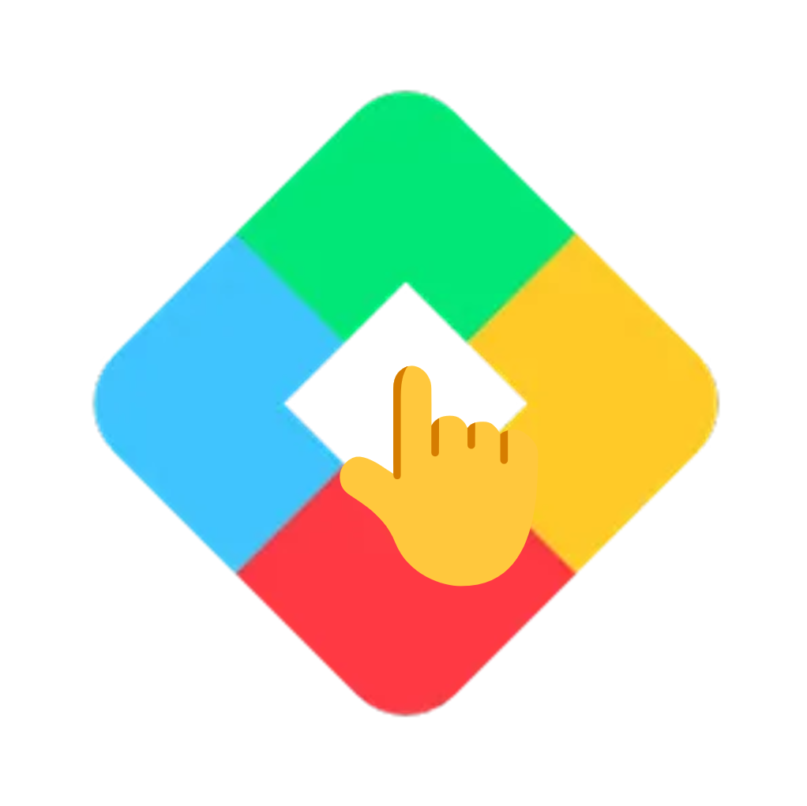

<h1>🎁 Auto Collect Play Points</h1>
Auto Collect Play Points during computer idle time! 🙂‍↕️    
 
 

A lightweight, ultra-low resource Chrome Extension for Auto Collect Play Points. 
極輕量、極低資源消耗的 自動領取 Play Points 擴充功能。
 
 

[繁體中文教學](#-繁體中文教學) • [English Tutorial](#-english-tutorial)
 
 

 

---

## 🇹🇼 繁體中文教學

### 什麼是 Google Play Points？誰有資格領取？
**Google Play Points** 是 Play 商店推出的獎勵計畫。玩家透過購買應用程式、遊戲或內購來累積點數，點數可用於兌換遊戲虛寶或抵用金。
*   **每週獎勵領取資格**：只要你的等級達到 **白銀級（Silver）、黃金級（Gold）、白金級（Platinum）或 鑽石級（Diamond）**，每週五凌晨都會獲得一次免費抽取寶箱（Weekly Perks）的機會。
*   **痛點**：每週都要手動打開網頁或應用程式點擊寶箱，常常一忙就忘記領取而白白浪費，這個擴充功能就是為了徹底解決這個問題而誕生的！

### ✨ 核心運作方式
運作方式非常簡單，完全零干擾：

1. 請先在瀏覽器的 Play 商店登入您的帳號。
2. 電腦閒置滿 10 分鐘後，程式會自動執行。
3. 只有在首次安裝或有新獎勵時，才會開啟分頁領取點數。
4. 領取完畢後會自動關閉分頁，完全不干擾您的日常使用。

### 🚀 安裝教學 (免上架直接安裝)
由於本工具為獨立開源腳本，請依照以下步驟將其安裝到您的 Chrome / Edge 瀏覽器：

1. 點擊頁面右側的 **[Releases](https://github.com/peter890331/Auto-Collect-Play-Points/releases)**，下載最新版本的 `Source code (zip)` 壓縮檔。
2. 將下載的檔案解壓縮到一個資料夾中。
3. 打開瀏覽器，**Chrome** 請在網址列輸入 `chrome://extensions/`，**Edge** 請輸入 `edge://extensions/`，或手動從設定進入擴充功能管理頁面。
4. 打開右上角的 **「開發人員模式 (Developer mode)」** 開關。
5. 點擊左上角的 **「載入未封裝項目 (Load unpacked)」** 按鈕。
6. 選擇你剛才解壓縮的資料夾，安裝即刻完成！享受自動領取的便利吧。

 

---

## 🇬🇧 English Tutorial

### What is Google Play Points & Who is Eligible?
**Google Play Points** is a rewards program launched by the Google Play. Players accumulate points by purchasing apps, games or in-app items, which can be used to redeem game items or store credit.
*   **Weekly Perks Eligibility**: As long as your level reaches **Silver, Gold, Platinum or Diamond**, you will get a free chance to draw a reward chest (Weekly Perks) every Friday.
*   **The Problem**: You have to manually open the webpage or app every week to click the chest, often you forget to claim it and it goes to waste when you are busy, this extension was born to completely solve this problem!

### ✨ How It Works
The process is very simple, completely non-intrusive:

1. First, log in to your account on the Google Play in your browser.
2. The extension runs automatically after 10 minutes of idle time.
3. It only opens a tab to collect points on first install or when new rewards are ready.
4. The tab closes automatically when finished, so it will not interrupt your work.

### 🚀 Installation Guide
Since this tool is an independent open-source script, please follow the steps below to install it on your Chrome / Edge browser:

1. Click **[Releases](https://github.com/peter890331/Auto-Collect-Play-Points/releases)** on the right side of the page, download the latest `Source code (zip)` file.
2. Extract the downloaded file into a folder.
3. Open your browser, for **Chrome** enter `chrome://extensions/` in the address bar, for **Edge** enter `edge://extensions/`, or manually open the extensions management page from settings.
4. Turn on the **"Developer mode"** switch in the top right corner.
5. Click the **"Load unpacked"** button in the top left corner.
6. Select the folder you just extracted, the installation is complete instantly! Enjoy the convenience of auto-collection.

 

---

## 📈 Star History

感謝您對開源專案的支持！如果這個工具為您省下了時間，請點擊右上角的 **⭐ Star** 給予鼓勵！ 
Thank you for supporting this open-source project! If this tool saved you time, please click the **⭐ Star** in the top right corner to encourage us!

<!-- 

  <a href="https://star-history.com/#peter890331/Auto-Collect-Play-Points&Date">
   <picture>
     <source media="(prefers-color-scheme: dark)" srcset="https://api.star-history.com/svg?repos=peter890331/Auto-Collect-Play-Points&type=Date&theme=dark" />
     <source media="(prefers-color-scheme: light)" srcset="https://api.star-history.com/svg?repos=peter890331/Auto-Collect-Play-Points&type=Date" />
     
   </picture>
  </a>

 -->
