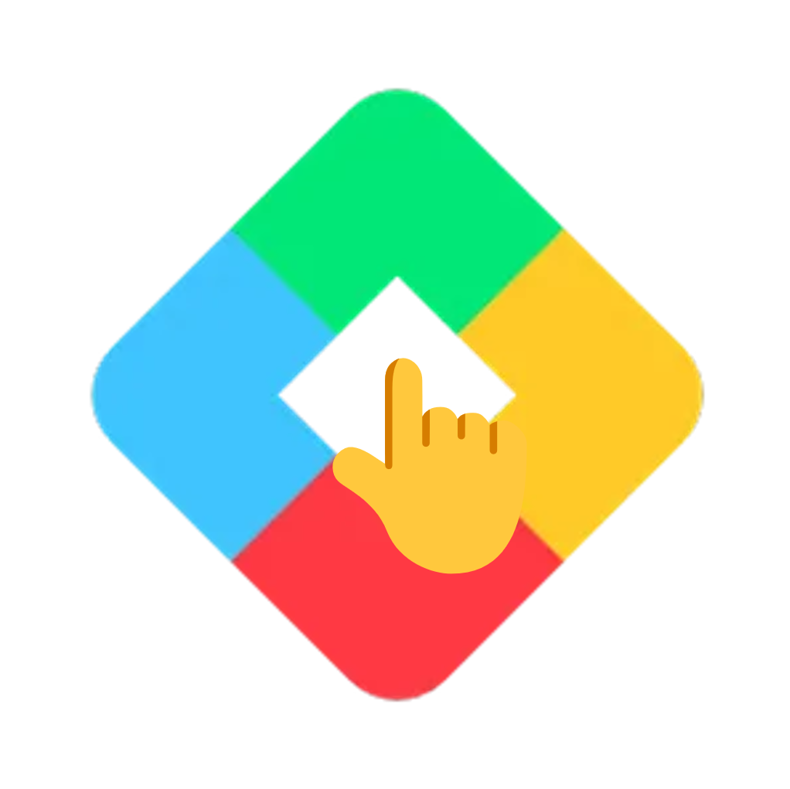

<h1>🎁 Auto Collect Play Points</h1>
Auto Collect Play Points during computer idle time! 🙂‍↕️    
 
 

A lightweight, ultra-low resource Chrome Extension for Auto Collect Play Points. 
極輕量、極低資源消耗的 自動領取 Play Points 擴充功能。
 

Automatically collect the weekly Play Points chests for you when you step away from your seat!  
在您短暫離開座位時，自動為您領取每週的 Play Points 寶箱！ 

[繁體中文教學](#繁體中文教學) • [English Tutorial](#english-tutorial)
 
 

 

---

## 繁體中文教學

### 什麼是 Google Play Points？
**Google Play Points** 是 Play 商店推出的獎勵計畫💥。  
玩家透過購買應用程式、遊戲、內購或抽取獎勵寶箱來累積點數，點數可用於兌換抵用金。  
*   **領取資格**：只要您的等級達到 **白銀級（Silver）、黃金級（Gold）、白金級（Platinum）或 鑽石級（Diamond）**，或是自去年起曾達到上述等級，每週五凌晨都會獲得一次免費抽取獎勵寶箱（Weekly Perks）的機會。
*   **手動痛點**：每週都要手動打開網頁或應用程式點擊寶箱。常常一忙就忘記領取而白白浪費😠。這個擴充功能就是為了徹底解決這個問題而誕生的！

### ✨ 如何運作
如果您平時有在使用電腦🖥️，無論是居家休閒或在公司辦公，只要安裝這個擴充功能，它就會在您短暫離開座位時，自動為您領取每週的 Play Points 寶箱。

流程非常簡單且完全零干擾：

1. 在瀏覽器安裝此擴充功能。
2. 在瀏覽器的 Play 商店登入您的帳號。
3. 搞定🫠。

從此以後，當遇到發放新獎勵的日子（或首次安裝時），在電腦閒置滿 10 分鐘，擴充功能會自動開啟 Play 商店分頁來領取點數。  
領取完畢後分頁會自動關閉，完全不干擾您的日常使用。

### 🚀 如何安裝
由於本工具為獨立開源腳本，請依照以下步驟將其安裝到您的 Chrome 或 Edge 瀏覽器：

1. 點擊頁面右側的 **[Releases](https://github.com/peter890331/Auto-Collect-Play-Points/releases)**，下載最新版本的 `Auto-Collect-Play-Points.zip` 壓縮檔。
2. 將下載的檔案解壓縮到一個資料夾中。
3. 打開瀏覽器，**Chrome** 請在網址列輸入 `chrome://extensions/`，**Edge** 請輸入 `edge://extensions/`，或手動從設定進入擴充功能管理頁面。
4. 打開右上角的 **「開發人員模式」** 開關。
5. 點擊左上角的 **「載入未封裝項目」** 按鈕。
6. 選擇您剛才解壓縮的資料夾，安裝即刻完成！享受自動領取的便利吧🤓。

### ⚠️ 免責聲明
本擴充功能僅為模擬人工點擊的自動化腳本，旨在協助使用者節省時間，並無任何惡意破解或修改 Google 伺服器數據之行為。  
惟使用自動化工具可能違反 Google Play 服務條款（ToS），請使用者自行評估使用風險。開發者不對因使用本工具而導致的任何帳號懲處、封鎖或損失承擔任何責任。

### ⭐ 給我星星
感謝您對開源專案的支持！如果這個工具為您省下了時間，請點擊右上角的 **⭐ Star** 給予鼓勵！

 

---

## English Tutorial

### What is Google Play Points? 
**Google Play Points** is a rewards program launched by Google Play 💥.   
Players accumulate points by purchasing apps, games, in-app items, or drawing reward chests, these points can be used to redeem store credit.
*   **Claim Eligibility**: As long as your level reaches **Silver, Gold, Platinum or Diamond**, or if you have reached these tiers since last year, you will get a free chance to draw a reward chest (Weekly Perks) every Friday.
*   **Manual Hassle**: You have to manually open the webpage or app every week to click the chest. Often you forget to claim it and it goes to waste when you are busy 😠. This extension was born to completely solve this problem!

### ✨ How It Works
If you regularly use a computer 🖥️, whether relaxing at home or working in the office, simply install this extension, and it will automatically collect the weekly Play Points chests for you when you step away from your seat.

The process is very simple and completely non-intrusive:

1. Install this extension in your browser.
2. Log in to your account on Google Play in your browser.
3. Done 🫠.

From then on, on the days when new rewards are available (or upon first installation), after your computer has been idle for 10 minutes, the extension will automatically open a Play Store tab to claim the points.   
The tab closes automatically when finished, completely without interrupting your daily use.

### 🚀 How To Install
Since this tool is an independent open-source script, please follow the steps below to install it on your Chrome or Edge browser:

1. Click **[Releases](https://github.com/peter890331/Auto-Collect-Play-Points/releases)** on the right side of the page, download the latest `Auto-Collect-Play-Points.zip` file.
2. Extract the downloaded file into a folder.
3. Open your browser, for **Chrome** enter `chrome://extensions/` in the address bar, for **Edge** enter `edge://extensions/`, or manually open the extensions management page from settings.
4. Turn on the **"Developer mode"** switch in the top right corner.
5. Click the **"Load unpacked"** button in the top left corner.
6. Select the folder you just extracted, the installation is complete instantly! Enjoy the convenience of auto-collection 🤓.

### ⚠️ Legal Disclaimer
This extension is solely an automated script that simulates human clicking to save users time, it does not maliciously hack or modify any Google server data.   
However, using automated tools may violate the Google Play Terms of Service (ToS), please evaluate the risks before using. The developer assumes no responsibility for any account penalties, bans, or losses resulting from the use of this tool.

### ⭐ Give me a Star
Thank you for supporting this open-source project! If this tool saved you time, please click the **⭐ Star** in the top right corner to encourage us!

 

---

<!-- <a href="https://www.star-history.com/?repos=peter890331%2FAuto-Collect-Play-Points&type=timeline&logscale=&legend=top-left">
 <picture>
   <source media="(prefers-color-scheme: dark)" srcset="https://api.star-history.com/chart?repos=peter890331/Auto-Collect-Play-Points&type=date&theme=dark&logscale&legend=top-left" />
   <source media="(prefers-color-scheme: light)" srcset="https://api.star-history.com/chart?repos=peter890331/Auto-Collect-Play-Points&type=date&logscale&legend=top-left" />
   
 </picture>
</a> -->
